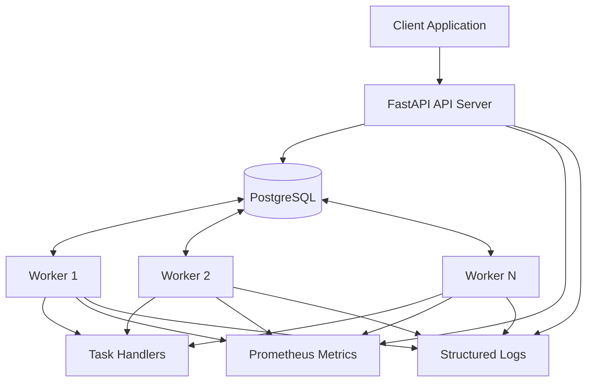
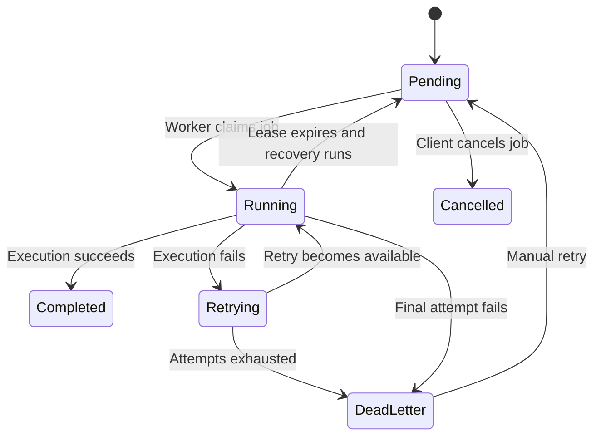

# RelayQueue

### A Fault-Tolerant Distributed Job Scheduling and Execution Platform

[](https://github.com/dineshkvs1304/RelayQueue/actions/workflows/ci.yml)


RelayQueue is a Python-based distributed job scheduling and execution platform built with **FastAPI, PostgreSQL, and SQLAlchemy**.

It allows clients to submit jobs through an API and distributes execution across multiple independent workers. It implements priority-based job claiming, transactional concurrency control, lease-based ownership, automatic retries, crash recovery, idempotent submission, and dead-letter handling.

The project demonstrates practical distributed-systems engineering concepts, including database locking, worker coordination, failure handling, execution tracking, and observability.

**Repository:** [github.com/dineshkvs1304/RelayQueue](https://github.com/dineshkvs1304/RelayQueue)

---

## Key Features

| Area | Implementation |
|---|---|
| Job submission | REST API with immediate and scheduled execution |
| Priority scheduling | Higher-priority jobs are selected first |
| Concurrent processing | Multiple independent workers |
| Safe job claiming | PostgreSQL `FOR UPDATE SKIP LOCKED` |
| Worker coordination | Registration, heartbeats, and lifecycle states |
| Execution ownership | Worker-specific expiring leases |
| Crash recovery | Expired jobs are recovered and made eligible for retry |
| Retry handling | Exponential backoff with a maximum delay |
| Dead-letter queue | Isolates jobs that exhaust their attempts |
| Idempotency | Prevents duplicate job creation for repeated requests |
| Job management | Cancellation, attempt history, and manual retry |
| Monitoring | Prometheus metrics for API and workers |
| Logging | Structured JSON logs and request correlation IDs |
| Database versioning | Alembic migrations |
| Quality checks | Pytest, Ruff, and GitHub Actions CI |

---

## System Architecture



### How It Works

1. A client submits a job through the FastAPI application.
2. The API validates the request and persists the job in PostgreSQL.
3. Workers independently poll the database for eligible jobs.
4. PostgreSQL row-level locking with `SKIP LOCKED` allows workers to claim different jobs without waiting on rows already locked by other workers.
5. The claiming transaction records execution ownership, increments the attempt count, and creates an attempt record.
6. The worker executes the registered task handler and renews its lease while processing.
7. Successful jobs are marked completed. Failed jobs are retried with exponential backoff or moved to the dead-letter queue.
8. If a worker stops renewing its lease, recovery logic makes the expired job eligible for another attempt.

---

## Job Lifecycle



Each execution attempt is recorded separately, allowing job history and failure details to be inspected.

---

## Technology Stack

| Category | Technology |
|---|---|
| Language | Python 3.11+ |
| API framework | FastAPI |
| Database | PostgreSQL |
| ORM | SQLAlchemy |
| Database driver | Psycopg 3 |
| Data validation | Pydantic |
| Configuration | Pydantic Settings |
| Migrations | Alembic |
| Monitoring | Prometheus Client |
| Testing | Pytest, HTTPX |
| Code quality | Ruff |
| CI | GitHub Actions |

---

## Project Structure

```text
RelayQueue/
│
├── .github/
│   └── workflows/
│       └── ci.yml
│
├── docs/
│   ├── architecture.md
│   ├── job-lifecycle.md
│   ├── database-design.md
│   ├── concurrency-and-reliability.md
│   ├── api-reference.md
│   └── testing-and-benchmarks.md
│
├── migrations/
│   └── versions/
│
├── scripts/
│
├── src/
│   └── relayqueue/
│       ├── api/
│       │   ├── routes/
│       │   │   ├── jobs.py
│       │   │   └── workers.py
│       │   ├── schemas/
│       │   └── dependencies.py
│       │
│       ├── core/
│       │   ├── config.py
│       │   └── logging_config.py
│       │
│       ├── database/
│       │   ├── base.py
│       │   └── connection.py
│       │
│       ├── models/
│       │   ├── job.py
│       │   ├── job_attempt.py
│       │   └── worker.py
│       │
│       ├── monitoring/
│       │   └── metrics.py
│       │
│       ├── services/
│       │   ├── job_service.py
│       │   ├── worker_registry_service.py
│       │   └── worker_service.py
│       │
│       └── workers/
│           ├── handlers.py
│           └── runner.py
│
├── tests/
├── alembic.ini
├── pyproject.toml
└── README.md
```

---

## Getting Started

### Prerequisites

- Python 3.11 or later
- PostgreSQL
- Git

### 1. Clone the repository

```bash
git clone https://github.com/dineshkvs1304/RelayQueue.git
cd RelayQueue
```

### 2. Create and activate a virtual environment

**Windows PowerShell:**

```powershell
python -m venv .venv
.venv\Scripts\Activate.ps1
```

### 3. Install dependencies

```powershell
python -m pip install --upgrade pip
pip install -e ".[dev]"
```

### 4. Create PostgreSQL databases

Create two databases:

- `relayqueue` — application database
- `relayqueue_test` — test database

For example, using `psql`:

```sql
CREATE DATABASE relayqueue;
CREATE DATABASE relayqueue_test;
```

### 5. Configure environment variables

Copy the example configuration:

```powershell
Copy-Item .env.example .env
```

Update `.env` with your local PostgreSQL credentials:

```env
RELAYQUEUE_DB_HOST=localhost
RELAYQUEUE_DB_PORT=5432
RELAYQUEUE_DB_USER=postgres
RELAYQUEUE_DB_PASSWORD=your_postgresql_password
RELAYQUEUE_DB_NAME=relayqueue
```

Keep your actual `.env` file private. Do not commit database credentials.

### 6. Apply database migrations

```powershell
alembic upgrade head
```

### 7. Start the API server

```powershell
uvicorn relayqueue.main:app --reload --port 8000
```

The API will be available at:

- API: http://localhost:8000
- Swagger UI: http://localhost:8000/docs
- ReDoc: http://localhost:8000/redoc
- Health: http://localhost:8000/health
- Metrics: http://localhost:8000/metrics

### 8. Start worker processes

Open separate terminal windows, activate the virtual environment, and start independent workers.

**Worker 1:**

```powershell
$env:RELAYQUEUE_WORKER_METRICS_PORT = "8001"
python -m relayqueue.workers.runner
```

**Worker 2:**

```powershell
$env:RELAYQUEUE_WORKER_METRICS_PORT = "8002"
python -m relayqueue.workers.runner
```

Each worker registers with the database and processes eligible jobs independently.

Worker metrics are exposed separately:

- Worker 1: http://localhost:8001
- Worker 2: http://localhost:8002

---

## API Overview

The API supports job submission, inspection, cancellation, retries, dead-letter inspection, and worker registration.

| Method | Endpoint | Description |
|---|---|---|
| POST | `/jobs` | Submit a job |
| GET | `/jobs` | List jobs with pagination and optional status filter |
| GET | `/jobs/{job_id}` | Get job details |
| DELETE | `/jobs/{job_id}` | Cancel a pending job |
| GET | `/jobs/dead-letter` | List dead-letter jobs |
| GET | `/jobs/{job_id}/attempts` | View execution history |
| POST | `/jobs/{job_id}/retry` | Manually retry a dead-letter job |
| POST | `/workers` | Register a worker |
| POST | `/workers/{worker_id}/heartbeat` | Send worker heartbeat |

### Example: Submit a job

```http
POST /jobs
Content-Type: application/json
Idempotency-Key: order-1001
```

```json
{
  "task_type": "echo",
  "payload": {
    "message": "Hello from RelayQueue"
  },
  "priority": 10,
  "max_attempts": 3
}
```

The API returns the created job with its ID and initial status.

Repeating the same request with the same idempotency key returns the existing job. Reusing the key with a different request payload returns a conflict.

For complete request schemas, response examples, and error codes, see [API Reference](docs/api-reference.md).

---

## Concurrency and Reliability

RelayQueue uses PostgreSQL as the coordination mechanism between workers.

### Concurrent job claiming

Workers use `SELECT ... FOR UPDATE SKIP LOCKED` to claim jobs within database transactions.

This allows concurrent workers to skip jobs already locked by another worker instead of blocking on the same job.

### Lease-based ownership

Each claimed job receives:

- A worker owner ID.
- A lease expiration timestamp.
- An execution attempt record.

Workers periodically renew their leases while executing jobs.

### Crash recovery

If a worker stops renewing its lease, the recovery process identifies expired running jobs, records the failed attempt, and makes the job eligible for another attempt or dead-letter handling.

### Retry and dead-letter handling

Failed jobs are retried with exponential backoff, starting at 5 seconds and capped at 300 seconds. Jobs that exhaust their configured attempts are moved to the dead-letter queue.

### Execution semantics

A job can be executed again if a worker fails after performing a task's external side effect but before recording successful completion. Task handlers that perform external side effects should therefore be designed to be idempotent.

RelayQueue provides lease-based recovery and retry handling; it does not claim exactly-once execution of arbitrary external side effects.

More details: [Concurrency and Reliability](docs/concurrency-and-reliability.md).

---

## Monitoring and Observability

RelayQueue exposes Prometheus metrics for monitoring job processing and worker activity.

Metrics include:

- Jobs processed by status.
- Job failures.
- Job retries.
- Job execution duration.
- Worker counts by status.
- Active jobs.

The API and each worker expose their own metrics endpoint.

Structured JSON logging includes timestamps, log levels, logger names, exception details, and request correlation IDs. The API accepts an `X-Request-ID` header or generates one when absent.

---

## Testing and Code Quality

The project includes API, database, worker lifecycle, registry, and concurrency tests.

Run the complete test suite:

```powershell
pytest
```

Latest verified local result:

```text
51 passed, 1 warning
```

Run formatting checks:

```powershell
ruff format --check .
```

Run lint checks:

```powershell
ruff check .
```

Check database migration consistency:

```powershell
alembic check
```

The project also includes a GitHub Actions workflow that validates code quality, migrations, and tests against PostgreSQL.

---

## Performance Experiments

RelayQueue was tested locally with multiple worker processes.

| Experiment | Jobs submitted | Jobs completed | Observed throughput |
|---|---:|---:|---:|
| Benchmark 1 | 100 | 100 | ~94.89 jobs/sec |
| Benchmark 2 | 500 | 500 | ~130.32 jobs/sec |

These are observed local results, not controlled production benchmarks. The measurements include the effects of the local environment, polling, and benchmark methodology. In particular, the processing observation window began after job submission.

See [Testing and Benchmarks](docs/testing-and-benchmarks.md) for methodology and limitations.

---

## Documentation

| Document | Description |
|---|---|
| [Architecture](docs/architecture.md) | System components and architecture |
| [Job Lifecycle](docs/job-lifecycle.md) | Job states and transitions |
| [Database Design](docs/database-design.md) | Tables, relationships, constraints, and indexes |
| [Concurrency and Reliability](docs/concurrency-and-reliability.md) | Locking, leases, retries, and crash recovery |
| [API Reference](docs/api-reference.md) | Endpoints, schemas, and responses |
| [Testing and Benchmarks](docs/testing-and-benchmarks.md) | Test coverage and performance experiments |

---

## Engineering Decisions and Trade-offs

| Decision | Reason |
|---|---|
| PostgreSQL-backed queue | Durable job storage and transactional coordination |
| `SKIP LOCKED` | Allow multiple workers to claim independent jobs |
| Lease-based ownership | Detect abandoned jobs and support recovery |
| Separate attempt records | Preserve execution history and failure information |
| Exponential backoff | Avoid immediate repeated retries |
| Idempotency keys | Reduce duplicate job creation from retried client requests |
| Prometheus metrics | Expose operational signals without coupling to a specific dashboard |

The implementation prioritizes correctness, recoverability, and clear execution ownership. It uses PostgreSQL for both persistence and worker coordination rather than introducing a separate message broker.

---

## Current Scope and Future Improvements

Potential next steps include:

- Distributed deployment and multi-host worker testing.
- Authentication and authorization for API endpoints.
- Worker autoscaling and configurable polling strategies.
- Rate limiting and per-tenant queue isolation.
- More extensive load testing under controlled conditions.
- Additional task handlers and external integrations.
- Centralized metrics dashboards and alerting.

These are future improvements, not claims about currently implemented functionality.

---

## Author

**Dinesh KVS**

[GitHub](https://github.com/dineshkvs1304)

---
