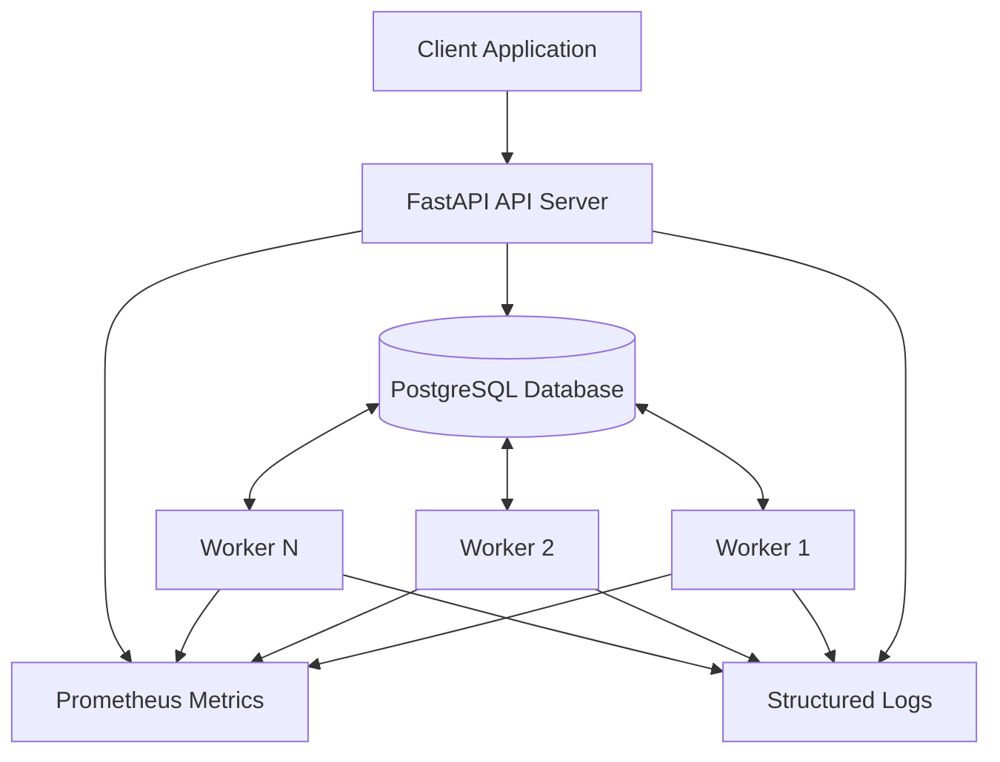

# RelayQueue

### A Fault-Tolerant Distributed Job Scheduling and Execution Platform

RelayQueue is a Python-based distributed job scheduling and execution platform built with FastAPI, PostgreSQL and SQLAlchemy.

It provides asynchronous job submission, priority-based scheduling, concurrent worker execution, lease-based job ownership, automatic retries, dead-letter handling and worker health monitoring.

The project explores practical distributed-systems concepts, including concurrency control, database transactions, failure recovery, idempotency and observability.

---

## Key Features

- **Job Scheduling:** Submit jobs for immediate or future execution.
- **Priority-Based Processing:** Higher-priority jobs are selected before lower-priority jobs.
- **Concurrent Workers:** Multiple workers can process independent jobs concurrently.
- **Safe Job Claiming:** PostgreSQL row-level locking with `FOR UPDATE SKIP LOCKED`.
- **Worker Registration and Heartbeats:** Track worker availability and lifecycle status.
- **Lease-Based Ownership:** Assign jobs to workers with expiring execution leases.
- **Automatic Recovery:** Recover jobs when worker leases expire.
- **Retry Mechanism:** Retry failed jobs using exponential backoff.
- **Dead-Letter Queue:** Isolate jobs that exhaust their retry attempts.
- **Idempotent Submission:** Support idempotency keys to prevent duplicate job creation.
- **Manual Job Management:** Cancel pending jobs and manually retry dead-letter jobs.
- **Prometheus Metrics:** Expose operational metrics for monitoring.
- **Structured Logging:** JSON logs with request correlation IDs.
- **Database Migrations:** Manage schema changes using Alembic.
- **Automated Testing:** Integration and concurrency tests with pytest.
- **Continuous Integration:** GitHub Actions validates the project.

---

## Architecture



### Main Components

| Component | Responsibility |
|---|---|
| FastAPI | Job and worker management APIs |
| PostgreSQL | Persistent job, worker and execution-attempt storage |
| SQLAlchemy | Database access and transaction management |
| Scheduler / Job Service | Job creation, scheduling and lifecycle operations |
| Worker Service | Job claiming, execution ownership and state transitions |
| Worker Runner | Polling, execution, heartbeat and lease renewal |
| Job Handlers | Execute registered task types |
| Prometheus Client | Expose application and worker metrics |
| Alembic | Database schema migrations |

---

## Technology Stack

| Category | Technologies |
|---|---|
| Language | Python 3.11+ |
| API Framework | FastAPI |
| Database | PostgreSQL |
| ORM | SQLAlchemy |
| Database Driver | Psycopg 3 |
| Validation | Pydantic |
| Configuration | Pydantic Settings |
| Migrations | Alembic |
| Monitoring | Prometheus Client |
| Testing | Pytest, HTTPX |
| Code Quality | Ruff |
| CI/CD | GitHub Actions |

---

## Project Structure

```text
RelayQueue/
│
├── .github/
│   └── workflows/
│       └── ci.yml
│
├── migrations/
│   └── versions/
│
├── src/
│   └── relayqueue/
│       ├── api/
│       │   ├── routes/
│       │   │   ├── jobs.py
│       │   │   └── workers.py
│       │   ├── schemas/
│       │   └── dependencies.py
│       │
│       ├── core/
│       │   ├── config.py
│       │   └── logging_config.py
│       │
│       ├── database/
│       │   ├── base.py
│       │   └── connection.py
│       │
│       ├── models/
│       │   ├── job.py
│       │   ├── job_attempt.py
│       │   └── worker.py
│       │
│       ├── monitoring/
│       │   └── metrics.py
│       │
│       ├── scheduler/
│       │
│       ├── services/
│       │   ├── job_service.py
│       │   ├── worker_registry_service.py
│       │   └── worker_service.py
│       │
│       └── workers/
│           ├── handlers.py
│           └── runner.py
│
├── tests/
│
├── alembic.ini
├── pyproject.toml
└── README.md
```

---

## Getting Started

### Prerequisites

Install the following:

- Python 3.11 or later
- PostgreSQL