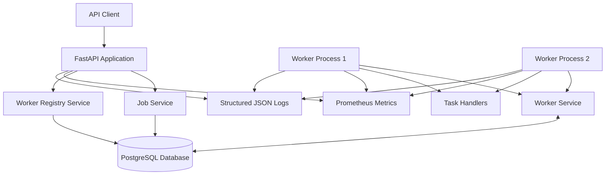
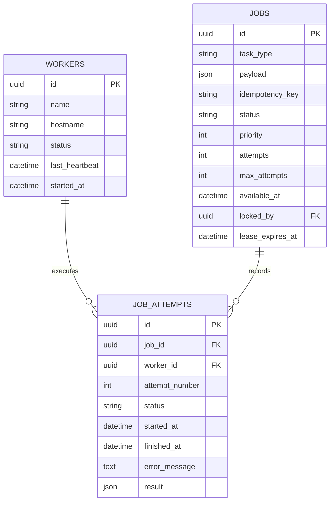

# RelayQueue — System Architecture

## 1. Overview

RelayQueue is a distributed job scheduling and execution platform built with Python, FastAPI, SQLAlchemy, and PostgreSQL.

The system allows clients to submit background jobs through a REST API. Registered worker processes claim available jobs, execute task handlers, and record their outcomes in PostgreSQL.

The architecture focuses on:

- Concurrent job processing
- Safe job claiming across multiple workers
- Lease-based execution ownership
- Automatic recovery of expired jobs
- Retry handling and dead-letter management
- Idempotent job submission
- Worker registration and heartbeat monitoring
- Structured logging and Prometheus metrics

## 2. High-Level Architecture

PostgreSQL acts as the shared coordination and persistence layer. Multiple worker processes communicate through the database rather than relying on direct worker-to-worker communication.

## 3. Main Components

| Component | Responsibility |
|---|---|
| FastAPI application | Exposes REST endpoints and health/metrics endpoints |
| Job Service | Creates jobs and handles job submission and idempotency |
| Worker Service | Claims jobs, manages leases, completes jobs, handles failures and recovery |
| Worker Registry Service | Registers workers, records heartbeats and updates worker status |
| Worker Runner | Runs the worker polling loop and manages execution |
| Task Handlers | Executes supported task types |
| PostgreSQL | Stores jobs, workers and execution attempts |
| Prometheus client | Exposes application and worker metrics |
| Logging module | Produces structured JSON logs and request correlation IDs |

## 4. Database Architecture

RelayQueue uses three primary database tables.

### 4.1 Jobs

The `jobs` table stores submitted jobs and their current execution state.

Important fields:

| Field | Description |
|---|---|
| id | UUID primary key |
| task_type | Identifies the task handler |
| payload | JSON task input |
| idempotency_key | Optional unique submission key |
| status | Current job state |
| priority | Job scheduling priority |
| attempts | Number of execution attempts |
| max_attempts | Maximum allowed attempts |
| available_at | Earliest time the job can be claimed |
| created_at | Job creation timestamp |
| updated_at | Last update timestamp |
| locked_by | Worker currently owning the job |
| lease_expires_at | Expiration time of the execution lease |

Important database constraints and indexes:

- Status check constraint.
- Attempt limit check constraint.
- Unique idempotency-key index.
- Index on status, availability time and priority.
- Index on status and lease expiration.

### 4.2 Workers

The `workers` table stores registered worker processes.

Important fields:

| Field | Description |
|---|---|
| id | UUID primary key |
| name | Worker name |
| hostname | Host running the worker |
| status | Active, offline or draining |
| last_heartbeat | Most recent heartbeat timestamp |
| started_at | Worker registration timestamp |

### 4.3 Job Attempts

The `job_attempts` table stores the execution history of each job.

Important fields:

| Field | Description |
|---|---|
| id | UUID primary key |
| job_id | Associated job |
| worker_id | Worker that executed the attempt |
| attempt_number | Sequential attempt number |
| status | Running, completed or failed |
| started_at | Attempt start timestamp |
| finished_at | Attempt completion timestamp |
| error_message | Failure details |
| result | JSON execution result |

A unique constraint on `(job_id, attempt_number)` prevents duplicate attempt numbers for the same job.

## 5. Entity Relationships

A job can have multiple execution attempts. Each attempt belongs to one job and can reference the worker that executed it.

## 6. Worker Execution Architecture

Each worker runs as an independent Python process.

The worker runner performs the following operations:

1. Registers itself in the worker registry.
2. Starts its Prometheus metrics endpoint.
3. Starts a background heartbeat thread.
4. Periodically checks for expired job leases.
5. Attempts to claim an available job.
6. Executes the task using the appropriate handler.
7. Renews the job lease while execution is in progress.
8. Records successful completion or failure.
9. Continues polling until shutdown is requested.

Workers use separate database sessions for their operations.

### Worker Timing Configuration

| Setting | Default |
|---|---:|
| Job lease duration | 30 seconds |
| Worker heartbeat interval | 10 seconds |
| Job polling interval | 2 seconds |
| Default worker metrics port | 8001 |

The worker metrics port can be configured using `RELAYQUEUE_WORKER_METRICS_PORT`.

## 7. Concurrent Job Claiming

Multiple workers can poll PostgreSQL simultaneously.

RelayQueue uses PostgreSQL row-level locking with `FOR UPDATE SKIP LOCKED` when claiming jobs.

This allows a worker to skip jobs already locked by another transaction instead of waiting for that transaction to finish.

The claim operation:

1. Locks an eligible worker record.
2. Finds an available pending or retrying job.
3. Locks the selected job row.
4. Assigns the job to the worker.
5. Increments the attempt count.
6. Sets the job status to running.
7. Creates a corresponding job-attempt record.
8. Sets the lease expiration timestamp.
9. Commits the transaction.

This database-level coordination prevents two workers from successfully claiming the same job in the same claim transaction.

## 8. Lease-Based Execution Ownership

When a worker claims a job, it receives temporary execution ownership through a lease.

The job stores:

- `locked_by`: the owning worker ID.
- `lease_expires_at`: the lease expiration timestamp.

The worker renews the lease periodically while the task handler is executing.

Before recording completion or failure, the worker service validates that:

- The job exists.
- The job is running.
- The attempt exists and is current.
- The worker owns the job.
- The lease has not expired.

If ownership or lease validation fails, the worker does not record the result as a successful completion.

## 9. Failure Recovery

If a worker stops unexpectedly, its job lease eventually expires.

The recovery process:

1. Finds running jobs whose leases have expired.
2. Locks eligible rows using `FOR UPDATE SKIP LOCKED`.
3. Marks the unfinished attempt as failed.
4. Records the lease-expiration error.
5. Clears the job's ownership and lease fields.
6. Moves the job to retrying or dead-letter status, depending on its attempt limit.

This allows other workers to claim jobs that were abandoned by unavailable workers.

## 10. Retry and Dead-Letter Handling

When a task handler fails, RelayQueue records the failure and determines whether the job can be retried.

The retry delay uses exponential backoff:

`delay = min(5 × 2^(attempts - 1), 300) seconds`

If the maximum number of attempts is reached, the job moves to the dead-letter state.

Dead-letter jobs can be inspected through the API, including their execution history. A manual retry endpoint is also available.

## 11. Worker Lifecycle

Workers support three registry states:

- `active`: worker is available for job processing.
- `draining`: worker is shutting down.
- `offline`: worker has stopped.

During graceful shutdown, the runner:

1. Receives the shutdown signal.
2. Marks the worker as draining.
3. Stops the heartbeat loop.
4. Marks the worker offline.
5. Shuts down its metrics server.
6. Restores previous signal handlers.

## 12. Observability

### Prometheus Metrics

RelayQueue exposes metrics for:

- Jobs processed by outcome.
- Job failures.
- Job retries.
- Job execution duration.
- Worker status.
- Active job executions.

The API exposes metrics at `/metrics`.

Each worker process exposes a separate metrics endpoint. By default, the first worker uses port `8001`; additional workers can use different configured ports.

### Structured Logging

The application uses JSON-formatted logs.

API requests receive a request ID through the `X-Request-ID` header. The ID is included in request logs and returned in the response, making it easier to correlate API activity.

Worker logs record job claims, execution outcomes, lease renewals, recovery events and shutdown activity.

## 13. Design Decisions

| Decision | Reason |
|---|---|
| PostgreSQL as coordination layer | Persistent storage and transactional row locking |
| UUID identifiers | Unique identifiers across jobs, workers and attempts |
| `FOR UPDATE SKIP LOCKED` | Supports concurrent job claiming |
| Lease-based ownership | Allows recovery after worker interruption |
| Separate job-attempt records | Preserves execution history |
| Exponential retry backoff | Avoids immediate repeated retries |
| Idempotency keys | Prevents duplicate submissions for matching requests |
| Independent worker processes | Supports multiple concurrent workers |
| Prometheus metrics | Makes operational behavior observable |

## 14. Reliability Semantics and Limitations

RelayQueue uses leases and retries to provide recovery from interrupted job execution.

However, a lease-based queue does not guarantee exactly-once execution of external side effects. A worker may perform an external operation and then fail before successfully recording completion. A later retry could execute that operation again.

Task handlers that perform external side effects should therefore use their own idempotency mechanisms.

The current implementation uses PostgreSQL as its coordination layer and does not require a separate message broker.

## 15. Current Architecture Scope

The implemented architecture includes:

- REST-based job submission and worker registration.
- PostgreSQL-backed job persistence.
- Concurrent job claiming.
- Worker heartbeats.
- Lease renewal and expiration recovery.
- Retry and dead-letter handling.
- Scheduled job availability through `available_at`.
- Idempotent job submission.
- Structured logging.
- Prometheus metrics.
- Automated tests and GitHub Actions CI.

This document describes the current implementation, not planned future components.