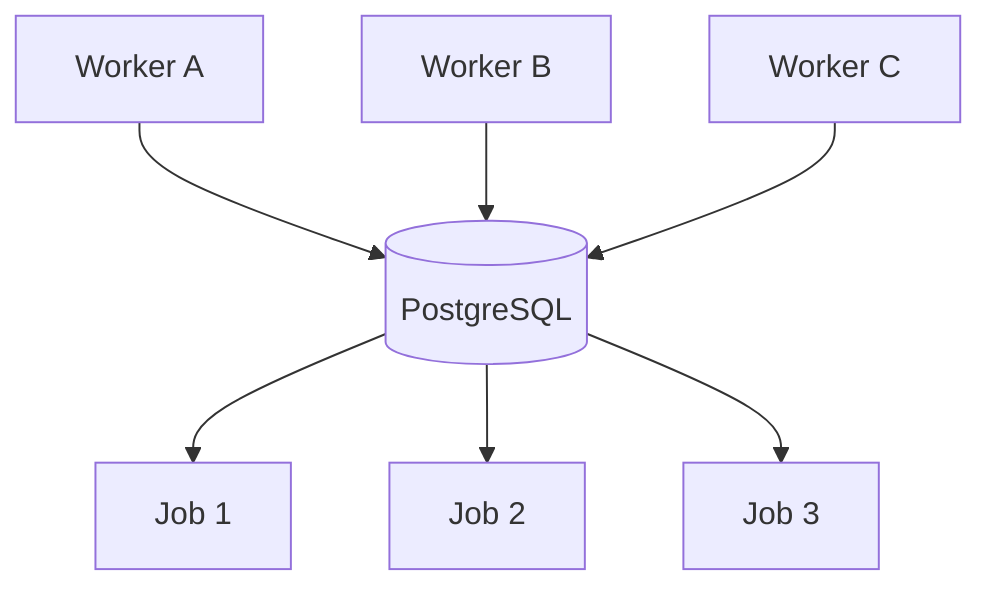
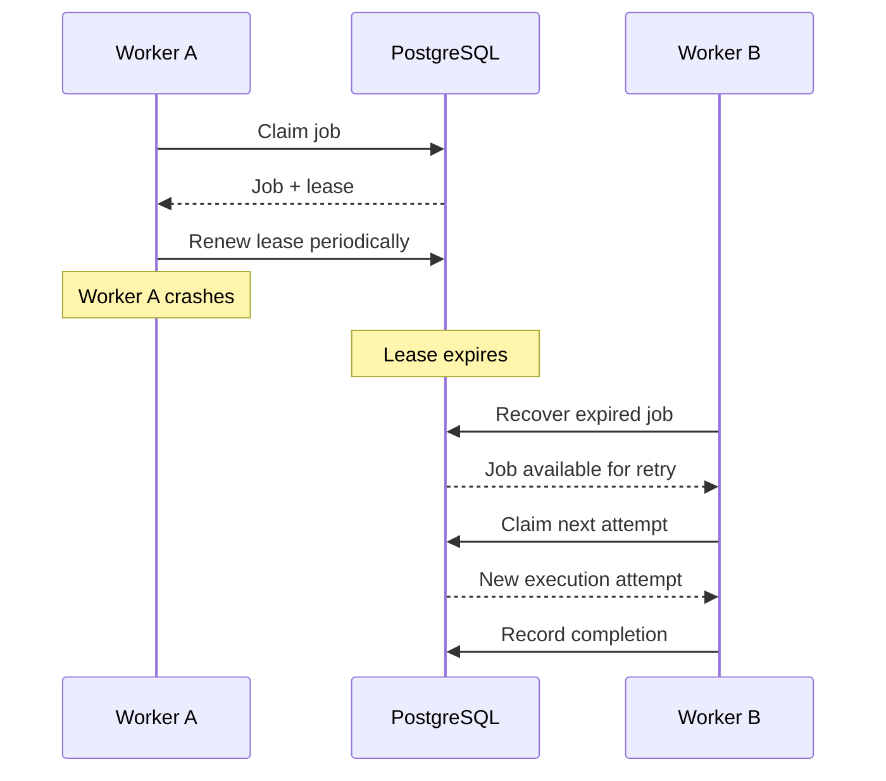

# RelayQueue — Concurrency and Reliability

## 1. Overview

RelayQueue is designed to support multiple worker processes executing background jobs concurrently while maintaining database-coordinated job ownership.

The reliability design uses PostgreSQL transactions, row-level locking, execution leases, periodic heartbeats, retry handling, and expired-job recovery.

The primary objectives are:

- Prevent competing workers from claiming the same job.
- Track which worker owns a running job.
- Detect interrupted worker execution.
- Recover jobs after lease expiration.
- Preserve execution-attempt history.
- Avoid duplicate job creation through idempotency keys.

## 2. Concurrent Worker Architecture

Multiple independent worker processes can connect to the same PostgreSQL database.

Each worker independently polls for eligible jobs.

PostgreSQL coordinates access to shared job records. Workers do not need direct communication with each other.

## 3. Row-Level Locking

RelayQueue uses PostgreSQL:

`SELECT ... FOR UPDATE SKIP LOCKED`

This mechanism is used during job claiming and expired-job recovery.

### Why SKIP LOCKED?

Consider two workers attempting to claim jobs at approximately the same time.

Without appropriate locking, both workers could select the same eligible job before either transaction updates its status.

With row-level locking:

1. Worker A selects and locks an eligible job.
2. Worker B encounters the locked row.
3. Worker B skips that row instead of waiting for it.
4. Worker B can select another eligible job.
5. Each worker commits its own claim transaction.

This allows concurrent workers to make progress without claiming the same job through the same claim transaction.

## 4. Atomic Job Claiming

The claim operation performs the ownership transition inside a database transaction.

The operation includes:

1. Selecting an eligible job.
2. Locking the selected row.
3. Assigning the worker ID.
4. Changing the status to `running`.
5. Incrementing the attempt count.
6. Setting the lease expiration.
7. Creating the job-attempt record.
8. Committing the transaction.

The claim operation ensures that the job state and execution-attempt record are persisted together.

## 5. Execution Ownership

Each running job contains two important ownership fields:

| Field | Purpose |
|---|---|
| `locked_by` | Identifies the worker that owns the job |
| `lease_expires_at` | Identifies when the ownership lease expires |

Before completing or failing a job, the worker service validates:

- The job exists.
- The job is currently running.
- The worker matches the recorded owner.
- The current attempt matches the expected attempt.
- The lease has not expired.

This prevents an outdated or unauthorized worker from recording a completion against a job it no longer owns.

## 6. Lease Renewal

A worker periodically renews its lease while executing a task.

Current configuration:

| Parameter | Value |
|---|---:|
| Lease duration | 30 seconds |
| Renewal interval | 10 seconds |

The worker runner starts a separate lease-renewal thread for each executing job.

The thread periodically opens a database session and requests lease renewal.

If renewal fails, the runner records that lease ownership may have been lost. It avoids recording the task as successfully completed or failed through the normal ownership-protected path.

## 7. Worker Heartbeats

Each worker periodically sends a heartbeat to the worker registry.

Default heartbeat interval: 10 seconds.

Heartbeat information helps track worker activity and registry status.

The worker registry supports:

- `active`
- `draining`
- `offline`

During graceful shutdown, the worker transitions to draining and then offline.

Heartbeats and job leases serve different purposes:

- Heartbeats track worker registry activity.
- Job leases track ownership of individual running jobs.

## 8. Crash Recovery

A worker may terminate unexpectedly while processing a job.

For example:

1. Worker A claims a job.
2. The job becomes `running`.
3. Worker A stops unexpectedly.
4. The lease is no longer renewed.
5. The lease expires.
6. Another worker's recovery loop detects the expired lease.
7. The unfinished attempt is marked failed.
8. The job is scheduled for retry or moved to the dead-letter state.

This design supports recovery without requiring direct detection of operating-system process termination.

## 9. Retry and Backoff

Failed jobs can be retried when execution attempts remain.

RelayQueue uses exponential backoff:

\[
delay = \min(5 \times 2^{attempts-1}, 300)
\]

The delay increases after each failed attempt and is capped at 300 seconds.

This reduces rapid repeated execution when a task or dependency is temporarily unavailable.

When the attempt limit is reached, the job transitions to `dead_letter`.

## 10. Idempotency and Duplicate Submissions

RelayQueue supports the `Idempotency-Key` HTTP header.

A unique database index protects the idempotency key.

The service compares the incoming request with the existing job:

- Matching request: returns the existing job.
- Different request with the same key: returns HTTP 409.
- New key: creates a new job.

This protects job submission against repeated client requests.

It does not automatically make external task side effects idempotent.

## 11. Concurrency Testing

RelayQueue includes a concurrency test using:

- 5 worker threads.
- 5 independent worker registrations.
- 20 submitted jobs.

The test verifies:

- Jobs are not claimed more than once in the tested claim scenario.
- Attempt records have unique attempt numbers.
- Each claim is associated with the correct worker.
- The resulting claims are consistent.

This test validates concurrent claim behavior against PostgreSQL.

It does not constitute a formal proof of correctness under every possible production workload.

## 12. Crash-Recovery Testing

The crash-recovery integration test simulates an interrupted worker by setting a running job's lease expiration into the past.

The test then:

1. Runs the expired-job recovery operation.
2. Verifies that the unfinished attempt is marked failed.
3. Makes the recovered job eligible for another claim.
4. Allows another worker to claim it.
5. Verifies that a new attempt is created.
6. Completes the job.

This validates the database-level lease recovery workflow.

The test simulates an expired lease rather than forcibly terminating an operating-system worker process.

## 13. Delivery Guarantees and Limitations

RelayQueue provides database-coordinated claims and lease-based recovery.

However, exactly-once execution of external side effects is not guaranteed.

A worker might successfully perform an external action and then crash before committing the completion status.

After lease recovery, another worker may execute the same task again.

For this reason, task handlers that interact with external services should implement idempotency at the operation level.

The current system does not claim that every task is executed exactly once.

## 14. Engineering Trade-offs

| Design choice | Advantage | Trade-off |
|---|---|---|
| PostgreSQL coordination | Transactional consistency and row-level locking | Database handles coordination workload |
| `SKIP LOCKED` | Concurrent workers avoid waiting on locked job rows | Requires PostgreSQL-compatible locking behavior |
| Lease-based ownership | Supports recovery after worker interruption | Lease duration and renewal must be managed |
| Separate attempt records | Preserves execution history | Additional database writes and storage |
| Exponential backoff | Reduces rapid repeated failures | Failed jobs may wait longer before retry |
| Independent worker processes | Supports concurrent execution | Requires worker lifecycle and metrics management |

## 15. Summary

RelayQueue combines PostgreSQL row-level locking, atomic job claiming, lease-based execution ownership, periodic lease renewal, worker heartbeats, retry backoff, and expired-job recovery.

Together, these mechanisms provide a foundation for concurrent and recoverable background job execution.