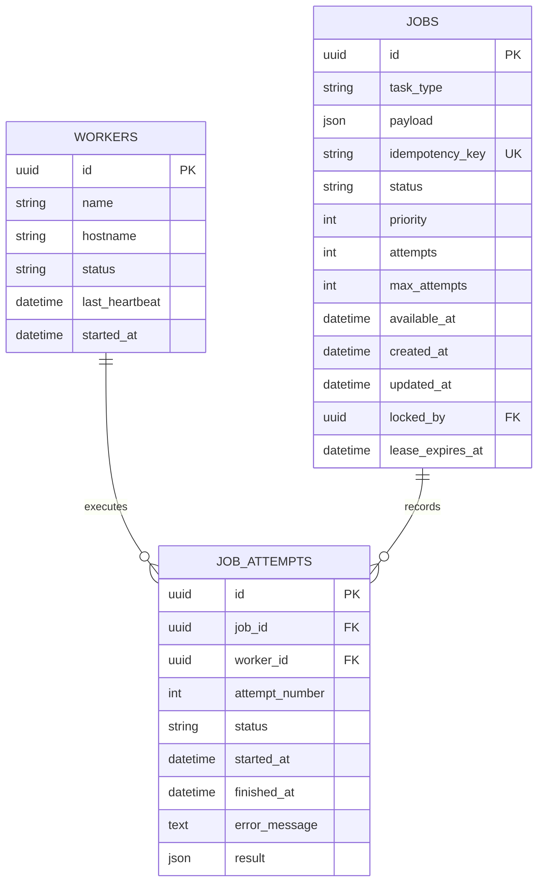

# RelayQueue — Database Design

## 1. Overview

RelayQueue uses PostgreSQL as its primary persistence and coordination layer.

The database stores:

- Submitted jobs and their current execution states.
- Registered workers and their lifecycle status.
- Individual job execution attempts.
- Job ownership and lease information.

SQLAlchemy is used as the ORM, while Alembic manages database schema migrations.

The database design supports concurrent workers, execution history, retry handling, and recovery from interrupted jobs.

## 2. Entity Relationship Diagram



## 3. Table Design

### 3.1 Jobs Table

Table name: `jobs`

The jobs table is the central entity of RelayQueue. It stores the submitted task, scheduling information, current state, execution limits, and ownership details.

| Column | Data type | Constraints / Purpose |
|---|---|---|
| id | UUID | Primary key |
| task_type | VARCHAR(100) | Required task identifier |
| payload | JSON | Required task input |
| idempotency_key | VARCHAR(255) | Nullable, unique when supplied |
| status | VARCHAR(20) | Required, defaults to pending |
| priority | INTEGER | Required, defaults to 0 |
| attempts | INTEGER | Required, defaults to 0 |
| max_attempts | INTEGER | Required, defaults to 3 |
| available_at | TIMESTAMP WITH TIME ZONE | Required, defaults to database time |
| created_at | TIMESTAMP WITH TIME ZONE | Required, defaults to database time |
| updated_at | TIMESTAMP WITH TIME ZONE | Required, defaults to database time |
| locked_by | UUID | Nullable foreign key to workers |
| lease_expires_at | TIMESTAMP WITH TIME ZONE | Nullable lease expiration |

#### Job Status Constraint

The database restricts job status values to:

- `pending`
- `running`
- `completed`
- `retrying`
- `failed`
- `dead_letter`
- `cancelled`

#### Attempt Limit Constraint

The database enforces:

`attempts >= 0 AND max_attempts > 0`

This prevents negative attempt counts and invalid execution limits.

### 3.2 Workers Table

Table name: `workers`

The workers table stores information about registered worker processes.

| Column | Data type | Constraints / Purpose |
|---|---|---|
| id | UUID | Primary key |
| name | VARCHAR(100) | Required worker name |
| hostname | VARCHAR(255) | Required machine hostname |
| status | VARCHAR(20) | Required, defaults to active |
| last_heartbeat | TIMESTAMP WITH TIME ZONE | Nullable heartbeat timestamp |
| started_at | TIMESTAMP WITH TIME ZONE | Required, defaults to database time |

#### Worker Status Constraint

Allowed worker statuses:

- `active`
- `offline`
- `draining`

The status check constraint ensures that only supported lifecycle states can be stored.

### 3.3 Job Attempts Table

Table name: `job_attempts`

This table preserves the execution history of jobs.

Instead of overwriting all execution information on each retry, RelayQueue creates a separate attempt record for every successful job claim.

| Column | Data type | Constraints / Purpose |
|---|---|---|
| id | UUID | Primary key |
| job_id | UUID | Required foreign key to jobs |
| worker_id | UUID | Nullable foreign key to workers |
| attempt_number | INTEGER | Attempt sequence number |
| status | VARCHAR(20) | Required execution status |
| started_at | TIMESTAMP WITH TIME ZONE | Required, defaults to database time |
| finished_at | TIMESTAMP WITH TIME ZONE | Nullable completion timestamp |
| error_message | TEXT | Nullable failure details |
| result | JSON | Nullable execution result |

#### Attempt Status Constraint

Allowed values:

- `running`
- `completed`
- `failed`

#### Unique Attempt Constraint

The database enforces:

`UNIQUE(job_id, attempt_number)`

This prevents duplicate attempt numbers for the same job.

## 4. Relationships and Referential Integrity

### Jobs and Job Attempts

Relationship: One-to-Many.

- One job can have multiple execution attempts.
- Every attempt belongs to a job.
- Deleting a job cascades to its associated attempts.

Foreign key:

`job_attempts.job_id → jobs.id`

Delete behavior: `ON DELETE CASCADE`.

### Workers and Job Attempts

Relationship: One-to-Many.

- A worker can execute multiple job attempts.
- An attempt can reference the worker that executed it.
- Worker deletion sets the attempt's worker reference to NULL.

Foreign key:

`job_attempts.worker_id → workers.id`

Delete behavior: `ON DELETE SET NULL`.

### Workers and Jobs

A job's `locked_by` field references the worker currently owning the job.

Foreign key:

`jobs.locked_by → workers.id`

Delete behavior: `ON DELETE SET NULL`.

## 5. Indexing Strategy

RelayQueue defines indexes to support common query patterns.

| Index | Columns | Purpose |
|---|---|---|
| `uq_jobs_idempotency_key` | idempotency_key | Enforces unique idempotency keys |
| `ix_jobs_status_available_priority` | status, available_at, priority | Supports available-job selection |
| `ix_jobs_status_lease_expiry` | status, lease_expires_at | Supports expired-lease recovery |
| `ix_job_attempts_job_started` | job_id, started_at | Supports execution-history lookup |

The indexes are intended to reduce the cost of frequently used scheduling, recovery, and history queries.

## 6. Job Claiming and Transaction Safety

PostgreSQL provides the row-level locking mechanism used by RelayQueue's workers.

When a worker claims a job, the service uses:

`SELECT ... FOR UPDATE SKIP LOCKED`

This allows multiple workers to search for jobs concurrently.

The selected job is locked within the claim transaction while its state, owner, attempt count, lease, and attempt history are updated.

The transaction is committed after the claim operation is complete.

This ensures that concurrent workers coordinate through PostgreSQL rather than relying on application-level timing assumptions.

## 7. Lease and Ownership Data

The `jobs` table stores two fields related to execution ownership:

### locked_by

Identifies the worker currently responsible for the running job.

### lease_expires_at

Stores the timestamp at which the worker's temporary execution ownership expires.

Together, these fields support:

- Ownership validation.
- Lease renewal.
- Detection of abandoned jobs.
- Recovery after worker interruption.

When a job is recovered or its execution finishes, the service clears the ownership and lease information as appropriate.

## 8. Idempotency Design

The `idempotency_key` field is nullable and protected by a unique index.

When a client submits a job with an idempotency key:

1. The service checks for an existing key.
2. Matching requests return the existing job.
3. Requests with different content return a conflict.
4. New keys are stored with the newly created job.

The database unique constraint provides a final consistency safeguard against duplicate key insertion.

## 9. Migration Management

RelayQueue uses Alembic to manage database schema changes.

Current migration history:

| Revision | Purpose |
|---|---|
| `311484e97ef6` | Create core job storage tables |
| `4b28d830ccbc` | Allow cancelled jobs |
| `97653e2723d9` | Add job lease ownership |
| `ad0d4807b13a` | Add job idempotency key |
| `eeba8a7e388c` | Correct job status constraint to include cancelled |

The latest migration is the current Alembic head.

### Applying Migrations

```powershell
alembic upgrade head
```

### Checking Migration History

```powershell
alembic history
```

### Checking the Current Head

```powershell
alembic heads
```

### Checking Model and Migration Consistency

```powershell
alembic check
```

The migration consistency check previously returned:

`No new upgrade operations detected.`

## 10. Database Configuration

Database settings are managed through Pydantic Settings.

Environment variables use the `RELAYQUEUE_` prefix.

Example:

```env
RELAYQUEUE_DB_HOST=localhost
RELAYQUEUE_DB_PORT=5432
RELAYQUEUE_DB_USER=postgres
RELAYQUEUE_DB_PASSWORD=your_postgresql_password
RELAYQUEUE_DB_NAME=relayqueue
```

The application constructs its PostgreSQL connection URL using SQLAlchemy's `URL.create`, avoiding manual connection-string interpolation.

## 11. Development and Test Databases

RelayQueue uses separate databases for application development and automated testing.

| Database | Purpose |
|---|---|
| `relayqueue` | Local application development |
| `relayqueue_test` | Automated test execution |

The test suite uses its own database configuration and SQLAlchemy sessions to isolate test data from development data.

## 12. Design Considerations

| Design choice | Benefit |
|---|---|
| UUID primary keys | Unique identifiers for distributed entities |
| JSON payloads | Flexible task input |
| Separate attempts table | Persistent execution history |
| Foreign key constraints | Referential integrity |
| Check constraints | Database-level validation |
| Unique idempotency index | Duplicate submission protection |
| Composite scheduling index | Supports job selection queries |
| Lease-expiry index | Supports recovery queries |
| Alembic migrations | Version-controlled schema evolution |

## 13. Summary

The RelayQueue database design uses three primary tables to represent jobs, workers, and execution attempts.

PostgreSQL provides persistent storage, transactional consistency, row-level locking, and the constraints required for concurrent job processing.

SQLAlchemy provides the application data-access layer, while Alembic provides controlled schema evolution.