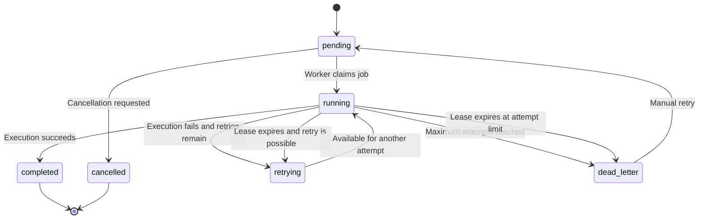

# RelayQueue — Job Lifecycle and State Management

## 1. Overview

RelayQueue manages background jobs through a defined lifecycle. Each job moves between execution states depending on whether it is waiting, running, completed, retrying, failed, or cancelled.

PostgreSQL stores the current job state and execution history. Workers coordinate through database transactions and temporary execution leases.

## 2. Job States

RelayQueue currently supports seven job states.

| State | Description |
|---|---|
| `pending` | Job is waiting to be claimed by a worker |
| `running` | A worker has claimed the job and is executing it |
| `completed` | Job execution finished successfully |
| `retrying` | Execution failed, but another attempt is scheduled |
| `failed` | Job execution failed |
| `dead_letter` | Job exhausted its configured execution attempts |
| `cancelled` | A pending job was cancelled |

## 3. Lifecycle Diagram

The `failed` state is also part of the database status constraint. The normal worker failure and lease-recovery paths described above use `retrying` or `dead_letter` as their resulting job states.

## 4. Job Submission

A client submits a job through:

`POST /jobs`

The API validates the request and passes it to the job service.

A new job is stored with:

- A generated UUID.
- A task type.
- A JSON payload.
- A priority.
- An attempt limit.
- An optional scheduled execution time.
- An initial `pending` status.

If a job has a future `scheduled_at` value, its `available_at` timestamp is set accordingly.

Workers only claim jobs whose `available_at` timestamp is not in the future.

## 5. Idempotent Submission

RelayQueue supports the `Idempotency-Key` request header.

When a client submits a request with an idempotency key:

1. The job service checks whether the key already exists.
2. If it does not exist, a new job is created.
3. If the key exists and the request matches the original job, the existing job is returned.
4. If the key exists but the request differs, the API returns HTTP 409 Conflict.

The database enforces uniqueness for non-null idempotency keys.

This protects against duplicate job creation when clients retry submissions after network errors or uncertain responses.

## 6. Job Claiming

Workers continuously poll PostgreSQL for available jobs.

The claim operation:

1. Verifies that the worker is active.
2. Searches for eligible pending or retrying jobs.
3. Orders candidates by priority and creation time.
4. Uses `FOR UPDATE SKIP LOCKED` to coordinate concurrent claims.
5. Changes the selected job to `running`.
6. Assigns the worker through `locked_by`.
7. Increments the attempt counter.
8. Creates a `job_attempts` record.
9. Sets `lease_expires_at`.
10. Commits the transaction.

The claim transaction ensures that competing workers cannot claim the same job through the same database locking mechanism.

## 7. Execution and Completion

After claiming a job, the worker executes its registered task handler.

If execution succeeds:

1. The worker stops its lease-renewal thread.
2. It checks whether lease ownership was lost.
3. It validates the current job and attempt ownership.
4. It marks the job as `completed`.
5. It records the attempt outcome.
6. It updates the relevant metrics.

A job is not marked completed if the worker detects that it has lost its lease.

## 8. Lease Renewal

A claimed job receives a temporary lease.

Default configuration:

| Setting | Value |
|---|---:|
| Lease duration | 30 seconds |
| Renewal interval | 10 seconds |

While a task is executing, a separate background thread periodically renews the lease.

The renewal operation validates that the worker still owns the current running attempt before extending the expiration time.

This prevents a worker from indefinitely retaining a job after its execution ownership has expired.

## 9. Failure and Retry Policy

If a task handler raises an exception, the worker records the failure.

When attempts remain, the job moves to `retrying` and receives a future `available_at` timestamp.

RelayQueue uses exponential backoff:

\[
delay = \min(5 \times 2^{attempts-1}, 300)
\]

| Attempt | Retry delay |
|---:|---:|
| 1 | 5 seconds |
| 2 | 10 seconds |
| 3 | 20 seconds |
| 4 | 40 seconds |
| 5 | 80 seconds |
| 6 | 160 seconds |
| 7 and later | 300 seconds maximum |

When the configured attempt limit is exhausted, the job moves to `dead_letter`.

## 10. Worker Crash Recovery

A worker can stop unexpectedly because of a process crash, machine shutdown, or other interruption.

RelayQueue uses lease expiration to detect abandoned jobs.

The recovery process:

1. Searches for jobs with `running` status and expired leases.
2. Locks eligible rows using `FOR UPDATE SKIP LOCKED`.
3. Marks the unfinished execution attempt as failed.
4. Records the error `Worker lease expired`.
5. Clears the worker ownership and lease fields.
6. Moves the job to `retrying` if attempts remain.
7. Otherwise, moves the job to `dead_letter`.

Another active worker can then claim the recovered job when it becomes available.

## 11. Cancellation

Clients can cancel a job through:

`DELETE /jobs/{job_id}`

The current API allows cancellation of pending jobs.

Expected outcomes:

| Condition | HTTP response |
|---|---:|
| Pending job successfully cancelled | 200 |
| Job does not exist | 404 |
| Job is not pending | 409 |

Running jobs are not cancelled by this endpoint.

## 12. Dead-Letter Queue

Jobs that exhaust their retry limit enter the `dead_letter` state.

RelayQueue provides endpoints to inspect and manage them:

| Endpoint | Purpose |
|---|---|
| `GET /jobs/dead-letter` | List dead-letter jobs |
| `GET /jobs/{job_id}/attempts` | View execution history |
| `POST /jobs/{job_id}/retry` | Manually retry a dead-letter job |

Manual retry resets the job to `pending` and updates its attempt allowance according to the current service policy.

The execution history remains available through the job-attempt records.

## 13. Execution History

Every successful claim creates a `job_attempts` record.

The record captures:

- Job ID.
- Worker ID.
- Attempt number.
- Execution status.
- Start timestamp.
- Finish timestamp.
- Error message, when applicable.
- Result, when available.

The unique constraint on `(job_id, attempt_number)` protects against duplicate attempt numbering.

This history helps investigate repeated failures, worker interruptions, and execution outcomes.

## 14. Delivery and Execution Guarantees

RelayQueue provides database-coordinated job claiming, lease-based ownership, and recovery of expired executions.

However, it does not guarantee exactly-once execution of external side effects.

For example, a worker might successfully call an external service and then crash before recording job completion. The recovered job may execute again.

Therefore, task handlers that perform external operations should implement their own idempotency protection.

## 15. Summary

The job lifecycle combines:

- Persistent job state.
- Concurrent worker claiming.
- Lease-based ownership.
- Periodic lease renewal.
- Automatic recovery of expired jobs.
- Exponential retry backoff.
- Dead-letter handling.
- Manual retry.
- Execution-attempt history.

These mechanisms provide a foundation for reliable background processing while keeping job coordination in PostgreSQL.